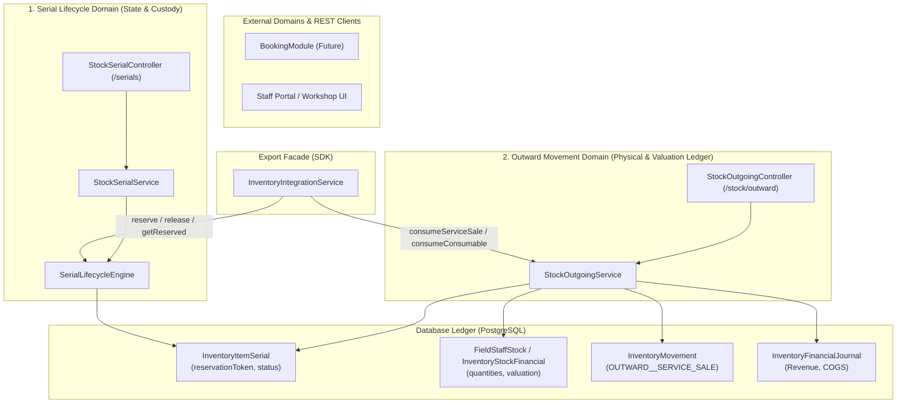

# Milestone Specification: Service Stock Separation & Outward Service Sale Isolation

- **Milestone ID**: `MLS-BE-OUT02-ISOLATION`
- **Subsystem**: Backend (`karigarji_server`)
- **Status**: 🟡 **PLANNING & DESIGN**
- **Date Initiated**: 2026-11-10
- **Governing Architecture Rules**: `.agents/rules/architectureRules.md`, `AGENTS.md` (Sections 1, 2, 6, 11)

---

## 1. Executive Summary & Root Problem Statement

In previous iterations, the concept of **Serial Lifecycle (Status & Custody Allocation)** was conflated with **Inventory Movement (Physical Outward Deduction & Financial Accounting)**. 

### The Core Architectural Misalignment
1. **Reserving & Releasing are NOT Movements**:
   - Reserving a serial (`reserveSerial`) or releasing a reservation (`releaseSerial`) does not move physical stock between warehouses, does not transfer custody between employees, does not change valuation, and does not post financial sub-ledger journals.
   - It is purely a **Serial Lifecycle & Custody Allocation State** on `InventoryItemSerial` (`reservationToken`, `reservedAt`). Placing reservation logic inside a "Consumption Engine" or "Outgoing Movement" controller was an architectural category error.
2. **Redundant Architectural Middle-Layer (`ServiceStockConsumptionEngine`)**:
   - Introducing an intermediate engine between `StockOutgoingService` and the database was an artificial abstraction.
   - `StockOutgoingService` already owns outward movements (`OUT-01` Direct Sale). It should naturally own `OUT-02` Service Sale as well.
3. **Pure Inventory Perspective**:
   - Inventory does not manage customer repair workflows, booking quote approvals, or customer OTPs.
   - Inventory's responsibility is strictly twofold:
     1. **Serial Lifecycle**: Allow authorized callers to reserve, release, and inspect serials.
     2. **Outward Movement**: Allow authorized callers to record the physical consumption and commercial sale of parts (`OUTWARD__SERVICE_SALE`).
   - Downstream domains (such as `BookingModule` or `RefurbishmentModule`) integrate strictly via the clean programmatic facade ([`InventoryIntegrationService`](file:///Users/karigarji/Documents/Yaantriki/repos/karigarji_workspace/karigarji_server/src/modules/stockOperations/exports/inventoryIntegration.service.ts)) or the dedicated Staff REST API.
4. **Zero Legacy / No Aliases Policy**:
   - As we are in active greenfield development, we maintain zero legacy debt: no deprecated aliases (`service-commit`, `workshop/commit`), and clean 1:1 endpoint naming.

---

## 2. Bounded Context Architecture & Separation of Concerns

---

## 3. Clear Domain Responsibilities

### Domain A: Serial Lifecycle (Soft-Allocation & Custody Lock)
* **Owner**: `StockSerialService` & `SerialLifecycleEngine`
* **Purpose**: Manages `reservationToken` and `reservedAt` on `InventoryItemSerial`.
* **Nature**: Non-movement metadata update. Zero financial impact. Zero movement ledger entry.
* **Operations**:
  1. `reserveSerial(serialNumber, reservationToken, staffId?, tx?)`:
     - Validates serial exists.
     - Validates serial status (`IN_FIELD_CUSTODY` or `IN_STOCK`).
     - If `staffId` is provided, ensures serial is in that specific technician's custody.
     - Sets `reservationToken = token`, `reservedAt = now()`.
  2. `releaseSerial(serialNumber, reservationToken, staffId?, tx?)`:
     - Validates serial exists and currently holds the specified `reservationToken`.
     - Clears `reservationToken = null`, `reservedAt = null`.
  3. `getReservedSerials(reservationToken, staffId?, tx?)`:
     - Queries all serials tagged with `reservationToken`.
* **REST Endpoints** (under `/staff/branches/:branchId/serials/`):
  - `POST /staff/branches/:branchId/serials/reserve`
  - `POST /staff/branches/:branchId/serials/release`
  - `GET  /staff/branches/:branchId/serials/reserved/:reservationToken`
* **Export Facade**:
  - `InventoryIntegrationService.reserveSerial(...)` delegates directly to `SerialLifecycleEngine`.
  - `InventoryIntegrationService.releaseSerial(...)` delegates directly to `SerialLifecycleEngine`.
  - `InventoryIntegrationService.getReservedSerials(...)` delegates directly to `SerialLifecycleEngine`.

---

### Domain B: Outward Movement — Service Sale (`OUT-02`)
* **Owner**: `StockOutgoingService` & `StockOutgoingController`
* **Purpose**: Records physical consumption, relieves custody, realizes COGS/Revenue, writes immutable movement, and posts double-entry financial journals.
* **Nature**: Core transactional movement with physical and financial ledger impact.
* **Operations**:
  1. `executeServiceSale(staffBranchId, requestedBranchId, dto, user?, externalTx?)`:
     - Ground-truth lookup: Resolves all serials reserved under `dto.referenceId`.
     - Validates that reserved serials are currently held by `dto.staffId` (or branch stock if workshop).
     - Atomically within transaction:
       - Transitions serials to `SerialStatus.INSTALLED`.
       - Sets `installedReference = dto.referenceId`, `installedAt = now()`.
       - Clears `reservationToken = null`.
       - Decrements technician custody (`FieldStaffStock.quantityOnHand`).
       - Decrements batch lots (`InventoryBatch.quantityOnHand`).
       - Creates immutable `InventoryMovement` row (`OUTWARD__SERVICE_SALE` or `OUTWARD__CUSTOMER_WARRANTY_ISSUE`).
       - Posts double-entry financial journals (Revenue + Landed COGS, or Warranty Expense).
  2. `consumeServiceConsumable(staffBranchId, requestedBranchId, dto, user?, externalTx?)`:
     - Decrements loose quantity (`FieldStaffStock.looseQuantityOnHand`).
     - Logs `InventoryMovement(OUTWARD__SERVICE_CONSUMABLE)`.
     - Posts expense journal.
* **REST Endpoints** (under `/staff/branches/:branchId/stock/outward/`):
  - `POST /staff/branches/:branchId/stock/outward/service-sale` *(Clean single route, zero aliases)*
  - `POST /staff/branches/:branchId/stock/outward/direct-sale` *(OUT-01)*
* **Export Facade**:
  - `InventoryIntegrationService.consumeServiceSale(...)` delegates directly to `StockOutgoingService.executeServiceSale`.
  - `InventoryIntegrationService.consumeServiceConsumable(...)` delegates directly to `StockOutgoingService.consumeServiceConsumable`.

---

## 4. Decommissioning & Cleanup Plan

1. **Delete Intermediate Engine**:
   - 🗑️ `src/modules/stockOperations/common/services/serviceStockConsumption.engine.ts`
   - 🗑️ `src/modules/stockOperations/common/services/serviceStockConsumption.engine.spec.ts`
2. **Delete Redundant DTOs**:
   - 🗑️ `src/modules/stockOperations/staff/dto/outward/staffServiceCommit.dto.ts`
3. **Clean Up Route Aliases in Controllers**:
   - Remove `service-commit`, `workshop/commit`, `branch-to-customer/direct-sale` legacy route aliases.
   - Clean, explicit routes:
     - `POST /staff/branches/:branchId/stock/outward/direct-sale`
     - `POST /staff/branches/:branchId/stock/outward/service-sale`
4. **Simplify `StockOperationsCommonModule`**:
   - Unregister `ServiceStockConsumptionEngine` from imports and exports.
5. **Direct Integration Facade**:
   - `InventoryIntegrationService` imports `SerialLifecycleEngine` (for reservation) and `StockOutgoingService` (for service sale). Zero middleman.

---

## 5. Verification & Audit Criteria

1. **Adversarial Unit Tests**:
   - `stockSerial.service.spec.ts` / `serialLifecycle.engine.spec.ts`: Test reservation, release, conflict rejection, and query.
   - `stockOutgoing.service.spec.ts`: Test `executeServiceSale` (van custody deduction, batch updates, serials $\to$ INSTALLED, financial posting, and zero-cost warranty claim).
   - `inventoryIntegration.service.spec.ts`: Test direct delegation to `SerialLifecycleEngine` and `StockOutgoingService`.
2. **Automated Verification**:
   - `npx tsc --noEmit` exits with 0 errors across entire server.
   - `npm test` passes with 0 failures across all 82 test suites.
   - `npm run build` compiles cleanly.
